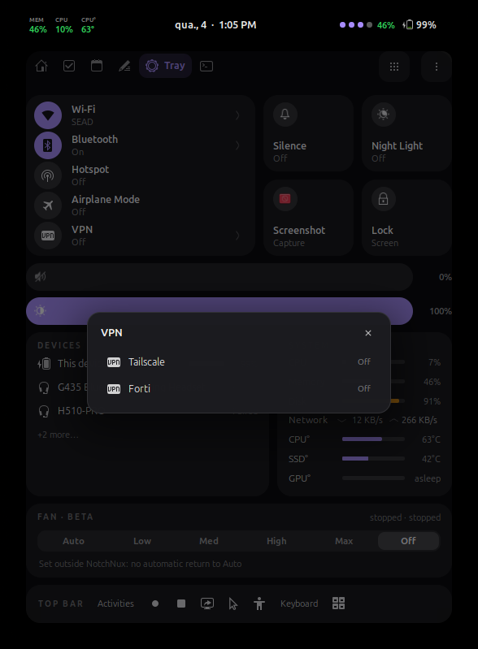
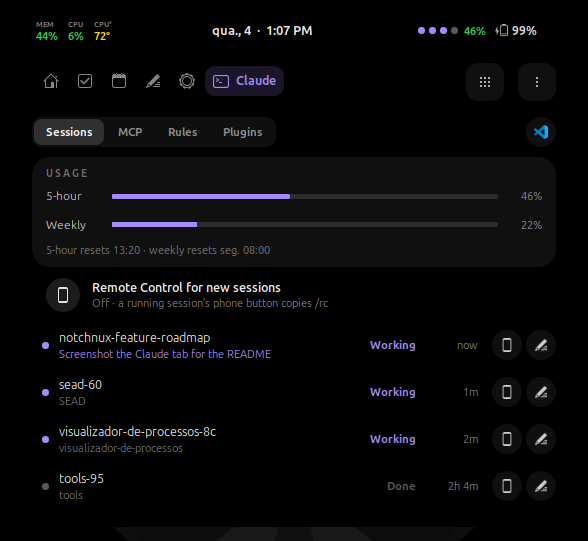
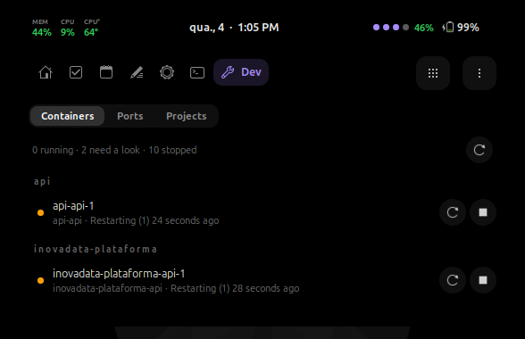
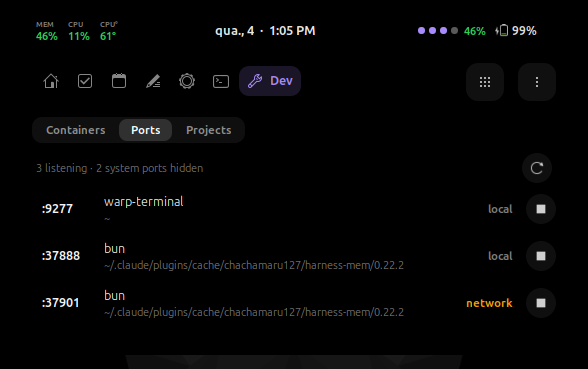
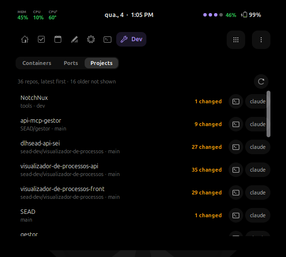

<div align="center">

# NotchNux

### A dynamic, macOS-style **Notch** and dashboard for GNOME Shell

A pill that lives at the top of your screen, morphs to show what you're doing, and springs open into a dashboard for your day: tasks, a focus timer, notes, music, calendar, weather, notifications, system controls with VPN and fan, a file shelf — and, for developers, your Claude Code sessions, Docker containers, open ports and git projects.


[](LICENSE)


</div>

---

## ✨ What is it?

NotchNux replaces the default GNOME top-bar clock with a **living pill**. At a glance it shows the date, time, battery and privacy (mic/camera) indicators, and optionally your Claude Code sessions, a connected VPN and CPU temperature. It hosts one **live activity** at a time — a running focus timer, or the track that's playing. When a notification arrives, the pill **morphs into a banner** with action buttons. Hover or click and it **springs open** into a dashboard that starts on **Home**: what's next today, your tasks, the focus timer and now-playing, all in one glance.


## 🧩 Features

| | Feature | What it does |
|---|---|---|
| 🏠 | **Home** | A glanceable start page: greeting and weather, your next calendar event, your top tasks with a quick-add field, the focus timer and now-playing controls. |
| ✅ | **Tasks** | A fast to-do list right under the notch. Type and press Enter to add (start with `!` to star it), click to edit, check off with a satisfying tick, review what you finished in **Done**. Optionally, the tab can show a Google Tasks list instead (see [Google Tasks & Calendar](#google-tasks--calendar-optional)). |
| ⏱️ | **Focus** | A Pomodoro-style timer (15 / 25 / 50 min) with automatic short and long breaks. While it runs, the countdown lives in the pill, **Do Not Disturb** turns on (optional), and you get a banner with *Start break* when time's up. Survives screen locks. |
| 📝 | **Notes** | A board of colour-coded post-its that autosave as you type. Pin any note to the desktop, where it sits on the wallpaper under your windows; drag it anywhere and double-click it to edit. A desktop-icons extension (such as Desktop Icons NG) draws its own layer over the wallpaper and can cover pinned post-its. Google Keep sync is not possible: its API only works for Google Workspace (business) accounts, not personal ones. |
| 🎵 | **Music / MPRIS** | Full player with album art, a spinning vinyl, scrubber, shuffle/repeat, and a volume dial — plus a lyrics view with timed lyrics from lrclib.net that follow the song. Works with any MPRIS player (Spotify, browsers, etc.). |
| 🌤️ | **Weather** | Current conditions, an analog clock, humidity, wind, sunrise/sunset and hourly forecast. Auto-locates or set a manual location. |
| 📷 | **Studio** | Live webcam preview (GStreamer) plus video and audio-only recording, with camera/mic device selection. |
| 📅 | **Calendar** | A scrollable day strip with your events pulled from GNOME Online Accounts — scroll the dates to jump between days. Optionally, create, edit and delete events from the notch (see [Google Tasks & Calendar](#google-tasks--calendar-optional)). |
| 🔔 | **Alerts** | Notification history, and a **peek** mode where the pill expands into a banner with action buttons the moment a notification arrives. |
| 🗂️ | **Shelf** | A click-to-browse / paste-a-file scratch space, plus **Quick Share** to send files to your phone and other paired [GSConnect](https://github.com/GSConnect/gnome-shell-extension-gsconnect) devices. |
| 🖥️ | **Tray / System** | A Control Center: Wi-Fi, Bluetooth, hotspot and airplane toggles with in-notch network and device pickers; a **VPN** row for Tailscale and the Forti VPN (openfortivpn, [one-time setup](#vpn-optional)); Silence, Night Light, screenshot and lock tiles; volume and brightness sliders; device batteries; live CPU, memory, disk and network; and the **power mode** (Saver · Balanced · Performance, from power-profiles-daemon, saying why when Performance is held back). Optional: CPU, SSD and GPU temperatures (a sleeping GPU reads *asleep* and is never woken to be read), and fan levels (Auto · Low · Med · High · Max · Off, beta, [one-time setup](#fan-control-beta-optional)) that go back to Auto at 85 °C unless you turn that off. |
| 🏝️ | **Island alerts** | Volume, brightness, charging, low battery, headphones and a 5-minute event heads-up grow out of the pill for a moment, one at a time. |
| 🫥 | **Hide when idle** | Optional: the notch tucks into the top edge until something is live, or you rest the pointer at the top centre. With the top panel hidden and its space reclaimed, it also tucks for a fullscreen video or game, so the app gets the screen to itself (alerts still show). |
| 🔲 | **Grid launcher** | Home plus one to eight shortcuts in the header (five by default; Preferences → Tabs → *Header shortcuts*); everything else (and the toggles) behind the grid button. Hold a tile to pick shortcuts. |
| 🤖 | **Claude Code** | Opt-in: a tab listing your running Claude Code sessions (working, needs approval, has a question, done, and how full each one's context is and what it has cost) with your 5-hour and weekly usage (and, at the last hour's pace, when the 5-hour window fills), plus a dot per session and the 5-hour % in the pill and a short alert when one finishes or needs you. Click a session to bring its terminal forward, or use its buttons to copy `/rc` (Remote Control) or `/rename`; a switch turns Remote Control on for new sessions. The tab's **MCP** view lists servers that need a login (from Claude Code's own cache) and, after *Check now* (`claude mcp list`, while a session is running), the ones that are connected and the ones that fail. A header button opens the view's file and folder in your editor (VS Code, Cursor or Antigravity, picked in Preferences). **Rules** switches the default mode for new sessions (Default / Accept edits / Plan / Auto) and lists the allow / ask / deny rules from your settings and each running session's folder, each removable with a confirming ×. **Plugins** turns Claude Code plugins on or off (through the `claude` CLI) and your personal and project skills (through `skillOverrides`). *Connect* in Preferences to see usage. Connect **Approve from the notch** to answer permission prompts with Allow / Always allow / Deny on a banner that stays until you answer (the terminal prompt keeps working; click the banner to hand it back to the terminal; in auto mode it shows only when Claude Code really asks). Connect **Show what sessions are doing** and a working session's row says what it's doing right now ("Editing tray.js", "Run the tests"); its hook runs in the background, so Claude Code never waits for it, and nothing changes in the pill. Everything stays on your machine. |
| 🛠️ | **Dev** | Opt-in (Preferences → Tabs): **Containers** lists your Docker containers by compose project (running, restarting, paused, and those that crashed in the last day); a row opens its logs in a terminal, its buttons restart, stop or start it, and its port chips open `http://localhost:PORT`. While the tab is enabled, `docker events` runs in the background so a container that crashes (one you didn't stop) raises an alert, and one that keeps restarting raises a second, then stays quiet until it has been up for 5 minutes. **Ports** lists what listens on a TCP port: your own processes (with the folder they run in) and Docker's published ports, each marked *local* or *network* (reachable from other machines); a row opens `http://localhost:PORT`, and stop asks once before ending it. **Projects** lists the git repositories in the folders you choose (Preferences → *Dev tab · Projects*), most recently used first, with branch, changed files and ahead/behind; a row opens it in your editor, and its buttons open a terminal or start Claude Code there. The terminal is your system default or **Warp** (Preferences → *Dev tab* → Terminal); Warp opens a new tab in the folder, running the command when there is one. |
| 📋 | **Clipboard** | The last 20 text clips with search and pins. Passwords are skipped; only pinned clips are saved. |
| ⏲️ | **Stopwatch, Keep Awake, Stats** | A stopwatch with laps, a keep-awake toggle, and memory/CPU (plus, optionally, the CPU, SSD or GPU temperature) in the pill. Two-finger swipe skips tracks; right-click the pill for a quick menu. |
| ⌨️ | **Keyboard shortcut & command bar** | **Super+/** (change it in Preferences → Keyboard) opens the notch with a command bar: `t <task>` adds a task (`!` stars it), `25` / `25m` / `1h` starts a focus timer, `=` does math, a tab name opens that tab, `n <note>` creates a new post-it. In the dashboard, ←/→ switch tabs, Ctrl+1…9 open a tab by position, Tab / Shift+Tab move focus, Esc closes (in a field, an open note or the Wi-Fi sheet, Esc leaves that first). Press the shortcut again to close. |
| 📡 | **Live activities** | Scripts and apps can show a short message or a progress bar in the pill over D-Bus (`io.github.notchnux`), or with the bundled `notchnux-activity` command. See [Live activities](#-live-activities). |
| 🔴 | **Screen sharing indicator** | A red icon in the pill while your screen is shared or recorded (a screencast, a remote-desktop or screen-sharing session); click it for a **Stop** button that ends them. |
| 🎨 | **Theming** | Pick any accent color, or on GNOME 47+ follow the system accent (Settings → Appearance) — the whole UI, dials and highlights recolor live. Reorder or hide dashboard tabs, and toggle individual features on/off, from a **native preferences window**. |

### Collapsed pill indicators
- 📆 Date & time (pill sizes to its content so the clock never truncates)
- 🔋 Battery percentage & charging state
- 🎤/📷 Privacy dots the moment the mic or camera is in use
- 🛡️ A VPN icon while Tailscale or the Forti VPN is connected
- 🔴 A screen-sharing / recording icon while your screen is shared or recorded — click it to stop
- ⏱️ Focus countdown while a session runs — click it to jump to the Focus tab
- 🎶 Now-playing title, scrolling while the track plays


## 🖼️ Screenshots

<div align="center">

**Home** — your day at a glance


**Tasks** — quick add, star, edit in place, tick off


**Focus** — Pomodoro timer with breaks, do-not-disturb and today's stats


**Notes** — post-its you can pin to the desktop


**Music** — vinyl art, scrubber, shuffle/repeat and a volume dial


**Weather** — analog clock, current conditions and details


**Tray / System** — connectivity, quick tiles, volume and brightness sliders, device batteries and live system meters


**Tray → VPN** — Tailscale and the Forti VPN in one list; temperatures (a sleeping GPU reads *asleep*) and fan levels below


**Calendar** — a scrollable day strip with your GNOME Online Accounts events


**Alerts** — grouped notification history with a live unread count


**Shelf** — a click-to-browse / paste-a-file zone with Quick Share to paired devices


**Studio** — live webcam preview plus camera & audio recording


**Claude** — your Claude Code sessions with 5-hour and weekly usage, and what each working session is doing


**Dev → Containers** — Docker containers by compose project, with restart, stop and logs; crash-looping ones in orange


**Dev → Ports** — what's listening, the folder it runs in, and whether it's local or on the network


**Dev → Projects** — your git repos, latest first, with branch and changes; open the editor, a terminal or Claude there


**Notification peek** — the pill smoothly expands into a banner with actions


**Preferences** — a native GTK/libadwaita settings window for accent, tabs and features


</div>

## 📦 Installation

### Requirements
- **GNOME Shell 46–51** (Wayland)
- `gnome-shell-extensions` (for the `gnome-extensions` CLI)
- **Optional:** GStreamer 1.0 (`gstreamer1-plugins-*` / `gstreamer1.0-plugins-*`) for the Studio webcam & recording tab

On **Fedora**:
```bash
sudo dnf install gnome-shell-extensions gstreamer1-plugins-good gstreamer1-plugins-bad-free
```

On **Ubuntu / Debian**:
```bash
sudo apt install gnome-shell-extensions gstreamer1.0-plugins-good gstreamer1.0-plugins-bad
```

### Install from source
```bash
git clone https://github.com/Adityasah2004/NotchNux.git
cd NotchNux
./install.sh
```

Then **reload GNOME Shell** so it loads the extension:
- **Wayland:** log out and log back in
- **X11:** press `Alt`+`F2`, type `r`, press `Enter`

The installer auto-enables the extension. If it couldn't, enable it manually:
```bash
gnome-extensions enable notchnux@adityasah.programs
```

### Try it without reloading your session
Run it in a separate GNOME Shell window so nothing touches your real desktop:
```bash
# GNOME 49 and newer
dbus-run-session -- gnome-shell --devkit --wayland
# GNOME 48 and older
dbus-run-session -- gnome-shell --nested --wayland
```

### Fan control (beta, optional)
Temperatures need nothing extra. Setting the fan level from the Tray needs a one-time setup that you run yourself (NotchNux never runs it):
```bash
sudo sh ~/.local/share/gnome-shell/extensions/notchnux@adityasah.programs/src/tools/fan-setup.sh
```
Then turn on **Fan control (beta)** in Preferences → *Temperatures & fan*. The switch stays greyed out until the setup has run, and its Copy button gives you this same command.

- It adds a udev rule (`/etc/udev/rules.d/90-notchnux-fan.rules`) that gives your user the fan's `pwm` files, and nothing else.
- On a ThinkPad it also turns on the firmware's fan watchdog: a manual level nobody re-sends for 2 minutes goes back to Auto (NotchNux re-sends it every minute). This applies to levels set any other way too, such as `echo level 0 > /proc/acpi/ibm/fan`. If `thinkpad_acpi` has fan control off, the script turns it on in `/etc/modprobe.d/notchnux-fan.conf` and asks for one reboot.
- `--no-watchdog` sets up without the ThinkPad watchdog (and turns it off if an earlier setup turned it on); `--remove` undoes everything.

NotchNux puts the fan back to Auto when the CPU reaches 85 °C or can't be read, when you turn the setting off, and when it stops (screen lock, logout). It never restores a manual level at login. Turn off **Back to Auto when hot** (under Fan control) to keep the level you set: however warm it gets, and across screen lock, suspend and login (NotchNux puts it back the moment it starts again, since GNOME stops extensions while the screen is locked). The processor still slows itself down when it gets too hot. While the screen is locked nothing re-sends the level, so with the ThinkPad watchdog on the fan returns to Auto after 2 minutes until you unlock; set up with `--no-watchdog` to avoid that. Resuming from suspend can also reset it in the firmware until you unlock.

### VPN (optional)
The Tray's **VPN** row needs nothing extra to show Tailscale (when installed) and the Forti VPN (when `openfortivpn` and its config, `/etc/openfortivpn/config`, exist). Connecting them from the notch without a password needs a one-time setup that you run yourself (NotchNux never runs it):
```bash
sudo sh ~/.local/share/gnome-shell/extensions/notchnux@adityasah.programs/src/tools/vpn-setup.sh
```
Then open Tray → **VPN**. Until the setup has run, Forti reads *Set up once* there, and its Copy button gives you this same command. Each part is set up only if that VPN is installed:

- **Forti:** it adds a systemd unit (`/etc/systemd/system/notchnux-forti.service`) that runs `openfortivpn -c /etc/openfortivpn/config`, and a polkit rule (`/etc/polkit-1/rules.d/50-notchnux-forti.rules`) that lets only your user start and stop that one unit, and nothing else. The unit never restarts by itself, so a wrong password can't loop and lock your account, and it never starts at boot. Your user and password stay in the config file, which only root can read.
- **Tailscale:** it runs `tailscale set --operator=$USER`, so `tailscale up` / `down` work without sudo.
- `--config FILE` uses another Forti config; `--remove` undoes everything.

If Forti says *Didn't connect*, `journalctl -u notchnux-forti` shows openfortivpn's own message.

### Google Tasks & Calendar (optional)
Both are off by default. NotchNux never signs in to Google itself and never sees your password: it goes through GNOME's own calendar service (Evolution Data Server), which syncs the Google account you add in GNOME Settings. Its calls run in a small helper process, so a slow network never freezes the desktop.

1. Install GNOME's calendar libraries for JavaScript:
   ```bash
   sudo apt install gir1.2-ecal-2.0 gir1.2-edataserver-1.2   # Ubuntu / Debian
   sudo dnf install evolution-data-server                    # Fedora
   ```
2. Add your Google account in **Settings → Online Accounts** with **Calendar** turned on (Google Tasks comes with it).
3. In NotchNux's Preferences, **Google** group:
   - **Google Tasks in the Tasks tab**, then pick a list (lists are shown as *list — account*). The Tasks tab and the Home card then add, tick, rename and delete in that list. Changes made elsewhere show after a refresh (automatic every 5 minutes while the tab is open, or the refresh button). Stars stay on this computer, since Google Tasks has no star. Your local tasks are kept and come back when you pick *Local*.
   - **Create and edit calendar events**: a **+** on the Calendar day strip, and Edit/Delete on events from calendars you can write to (read-only ones, like holidays and birthdays, get no buttons). For a repeating event, Edit changes that occurrence and Delete asks *This event* or *All events*. Changing the time of an event that spans several days keeps its end date. `Esc` (even from a field) backs out of the editor or event sheet.

If a change can't be saved (offline, signed out), the notch puts things back as they were, says *Couldn't save to Google* (*Couldn't save the event* for calendar events) with the reason, and keeps what you typed. If the save timed out, it re-reads the list instead, since the change may have gone through. If the picked list was deleted on the web or its Google account removed, the Tasks tab and the Home card say *This list is gone — pick another list* instead of showing stale tasks. When the list can't be reached right after login (offline, accounts not ready yet), it tries once more 30 seconds later.

When something is missing, Preferences' **Status** row says so: without the libraries it shows the install command above (with a copy button) for either switch, and with Google Tasks on but no Google lists found it says to add a Google account in Settings → Online Accounts. The Calendar tab says *Calendar editing isn't available* with the reason in place of the calendar picker. Google Keep can't be synced (see Notes).

## 🕹️ Usage

- **Hover or click the pill** to open the dashboard; click outside to collapse it.
- **Switch tabs** with the icon rail at the top (or scroll over it). Each tab keeps its place, so switching back is instant.
- **Type right in the notch** — the Tasks and Notes fields take the keyboard while focused; `Esc` hands it back.
- **Open preferences** (⋯ → *NotchNux Settings…* in the dashboard, or `gnome-extensions prefs notchnux@adityasah.programs`) to change the accent color, reorder or hide tabs, and toggle features. Changes apply to the live notch instantly — no shell reload needed.

Configuration is stored as plain JSON under `~/.config/notchnux/config.json` — no GSettings schema required. The preferences window and the running notch share this file, so edits made in either place take effect immediately.

## 📡 Live activities

Anything that can call D-Bus can put a live activity in the pill: a title, an optional line of text, an optional progress bar and an icon. Turn it off in Preferences → Features → *Live activities API*; while it's on, NotchNux owns the session-bus name `io.github.notchnux`.

```bash
id=$(notchnux-activity show "Build" --body "compiling" --progress 0.2 --timeout 60)
notchnux-activity update "$id" --body "linking" --progress 0.8
notchnux-activity end "$id"
```

`install.sh` offers to link `notchnux-activity` into `~/.local/bin` (it's in `src/tools/` of the installed extension). Without it, call the interface directly:

```bash
gdbus call --session --dest io.github.notchnux --object-path /io/github/notchnux/Activities \
  --method io.github.notchnux.Activities.Show "Build" "compiling" "system-run-symbolic" 0.2 60
```

| Method | Arguments → result |
|---|---|
| `Show` | `title` s, `body` s, `icon` s, `progress` d, `timeout` u → `id` s |
| `Update` | `id` s, `title` s, `body` s, `progress` d → `ok` b (an empty title or body, or progress -2, keeps the old value) |
| `End` | `id` s → `ok` b |

Progress is 0–1 (-1 = no bar). An activity stays until `End`, its timeout (1–600 s; 0 = 8 s) or a click on the bar. Limits: at most 8 activities at once, 20 calls a second per caller, titles cut at 60 characters and bodies at 120. Text is shown as plain text; the icon is a themed icon name (anything else shows the default). Errors come back as `io.github.notchnux.Error.TooMany` or `.RateLimited`.

## ⚙️ Configuration & data locations

| Path | Contents |
|---|---|
| `~/.config/notchnux/config.json` | Accent color, tab order & visibility, feature toggles, the Dev tab's project folders |
| `~/.config/notchnux/settings.json` | Weather location and the last forecast |
| `~/.local/share/notchnux/tasks.json` | Your tasks |
| `~/.local/share/notchnux/notes.json` | Your post-it notes (an old `notes.md` is migrated once and kept as `notes.md.bak`) |
| `~/.local/share/notchnux/gtask-stars.json` | Stars on Google tasks (Google Tasks has no star field) |
| `~/.local/share/notchnux/focus.json` | Focus timer state and today's stats |
| `~/.local/share/notchnux/shelf/` | Files added to the Shelf (cleared once per login) |
| `~/.cache/notchnux/` | Album art, wallpaper thumbnails and processed wallpapers (pruned automatically) |

Everything is stored locally, readable only by you (`0600` files in `0700` folders). Nothing is uploaded; the only network requests are the weather forecast (Open-Meteo), place-name lookups (OpenStreetMap Nominatim) and album art from your music player. While *Approve from the notch* or *Show what sessions are doing* is connected, NotchNux also listens on a socket in your runtime folder (`$XDG_RUNTIME_DIR/notchnux-claude.sock`) for Claude Code's hooks, which reach it with `curl`; only your own user can connect to it. The Dev tab and the VPN row run local commands (`docker`, `ss`, `git`, `tailscale`) and talk to systemd; they send nothing anywhere themselves.

> **Quick Share** sends files through the [GSConnect](https://github.com/GSConnect/gnome-shell-extension-gsconnect) extension. Install and pair a device in GSConnect to send files to your phone from the Shelf. Pasting a copied file into the Shelf uses `wl-clipboard` (`wl-paste`) on Wayland.

## 🐛 Troubleshooting

- **Nothing appears after install** → you must reload the shell (log out/in on Wayland). Confirm it's enabled: `gnome-extensions info notchnux@adityasah.programs`.
- **Studio tab is empty / no webcam** → install the GStreamer plugins listed above.
- **Check logs** while it runs:
  ```bash
  journalctl -f -o cat /usr/bin/gnome-shell
  ```
  NotchNux logs each distinct error once. For verbose diagnostics (WiFi,
  Bluetooth, brightness, weather fallbacks), start GNOME Shell with
  `NOTCHNUX_DEBUG=1` in its environment.
- **Clipboard tab missing** → clipboard history is opt-in; enable it in Preferences → Tabs.
- **VPN row says "Set up once"** → run the [one-time setup](#vpn-optional). If Forti says *Didn't connect*, `journalctl -u notchnux-forti` shows openfortivpn's own message.
- **Fan control (beta) greyed out** → run the [one-time setup](#fan-control-beta-optional), and reboot if it asks you to. It's hidden when no fan here can be set by software.

## 🧪 Testing

`tests/headless-smoke.sh` boots a throwaway headless GNOME Shell (its own D-Bus session, settings and data folders; your real session is never touched), loads the extension from the working tree, opens every tab and saves a screenshot of each to `tests/out/`. It fails if the extension doesn't activate, a tab doesn't open within 20 s, or NotchNux logs a `JS ERROR`/`CRITICAL`.

```bash
tests/headless-smoke.sh                  # all tabs, exit 0 = pass, 1 = a check failed, 2 = environment unusable
tests/headless-smoke.sh --tabs home,notes --src /path/to/other/checkout
```

It needs `gnome-shell`, `dbus-broker-launch` (the broker needs systemd user units) and a GPU render node (`/dev/dri/renderD*`). A run takes about 30 s to 2 min. Extra options: `--script FILE` (extra checks, sourced with the helpers from `tests/headless/lib.sh`), `--data SRC:REL` (seed a file under the test profile's `~/.local/share`), `--keep`, `--out DIR`.

`tests/eds-check.sh` tests the Google Tasks & Calendar helper against a private copy of GNOME's calendar service (its own D-Bus session and folders), so your real calendars and Google account are never touched. It needs the libraries from step 1 of Google Tasks & Calendar.

## 🤝 Contributing

This is a young project and **help is very welcome** — bug reports, feature ideas, theming tweaks, and PRs all make it better. If you're on Fedora (or any GNOME distro) and try it out, please open an issue with what worked and what didn't. 🙏

1. Fork the repo and create a branch.
2. Make your change and test it in a nested session.
3. Open a pull request describing what you changed and why.

To build the zip for [extensions.gnome.org](https://extensions.gnome.org/upload/), run `./pack.sh`; it writes `dist/notchnux@adityasah.programs.shell-extension.zip` with only the runtime files.

## 👥 Contributors

- **Aditya Sah** ([Adityasah2004](https://github.com/Adityasah2004)) — created NotchNux.
- **Gabriel Coelho** ([gabrielfmcoelho](https://github.com/gabrielfmcoelho)) — the Claude Code integration (sessions, usage, approvals from the notch, what sessions are doing), temperatures and fan control, the VPN row, the Dev tab (containers, ports, projects) and the header shortcuts.

Thanks to everyone who [sent a pull request](https://github.com/Adityasah2004/NotchNux/graphs/contributors).

## 📄 License

Released under the [MIT License](LICENSE). © 2026 Aditya Sah.
